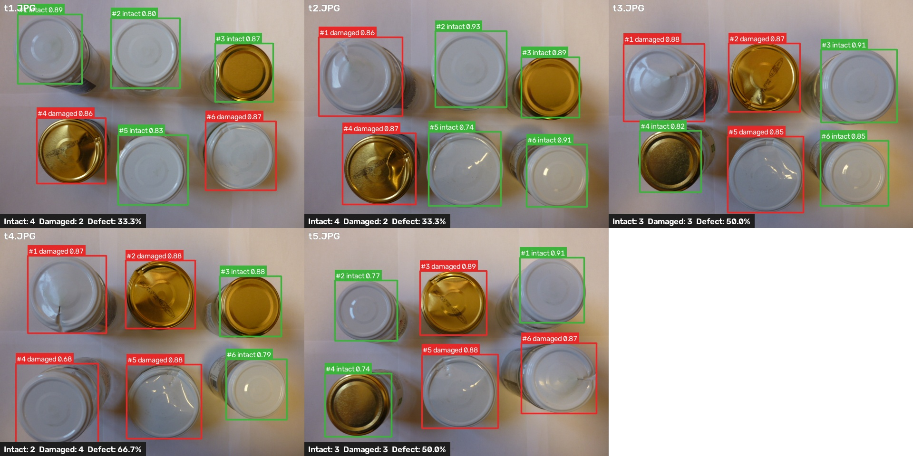
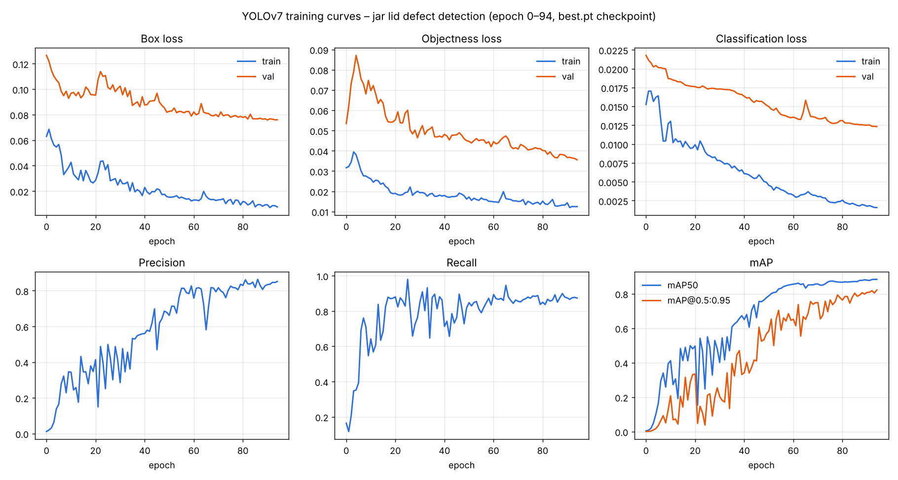
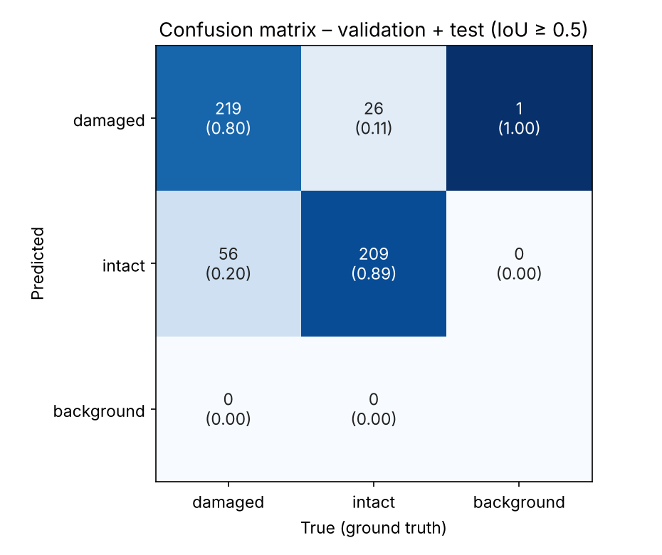
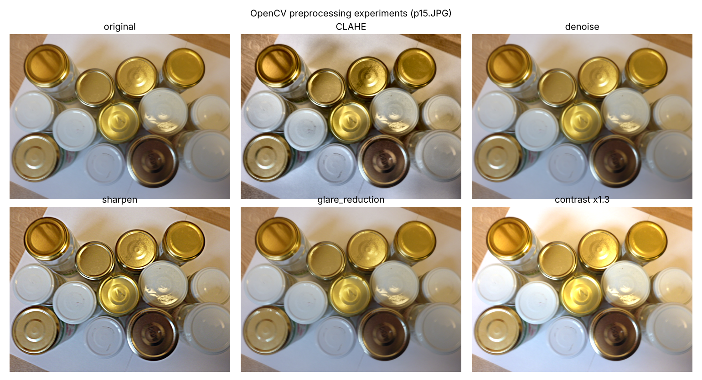

# 🔍 Product Defect Detection – Jar Lids (YOLOv7)

ระบบตรวจจับตำหนิบนฝาขวด/ฝาภาชนะด้วย Computer Vision โดยใช้ **YOLOv7** ระบุตำแหน่งฝาแต่ละใบในภาพหรือวิดีโอ
แยกเป็น **ฝาปกติ (intact)** และ **ฝาที่มีตำหนิ (damaged)** แสดงผลเป็น Bounding Box
และนับจำนวน/คำนวณอัตราตำหนิ ผ่าน Web Application ที่สร้างด้วย **Streamlit**



## คุณสมบัติ

- ตรวจจับฝาปกติ / ฝามีตำหนิ จาก **ภาพ** (อัปโหลดได้หลายภาพพร้อมกัน) และ **วิดีโอ**
- แสดง Bounding Box พร้อมชื่อคลาสและค่าความมั่นใจ (confidence)
- สถิติ: จำนวนฝาทั้งหมด, ฝาปกติ, ฝามีตำหนิ, อัตราตำหนิ (%), สถานะ PASS/FAIL, เวลาประมวลผล
- วิดีโอ: กราฟจำนวนฝาปกติ/มีตำหนิในแต่ละช่วงเวลา, ดาวน์โหลดวิดีโอผลลัพธ์
- ปรับภาพด้วย OpenCV ก่อนตรวจจับได้ (CLAHE, ลดแสงสะท้อน, ลด Noise, Sharpen, Brightness/Contrast)
- ปรับ Confidence / IoU threshold ได้จากหน้าเว็บ
- หน้า **ผลการประเมินโมเดล**: Learning curve, Confusion matrix, Precision/Recall/F1
- ดาวน์โหลดภาพผลลัพธ์และสรุปผลเป็น CSV

## โครงสร้างโปรเจกต์

```text
ProductDefect/
├── app.py                      # Streamlit web application
├── requirements.txt
├── README.md
├── best.pt                     # น้ำหนักโมเดล YOLOv7 ที่ฝึกแล้ว (ตัด optimizer ออก, FP16, ~75 MB)
├── ProductDefect.ipynb         # Notebook เตรียมข้อมูล + Train + Test (Google Colab)
├── src/
│   ├── detection.py            # โหลดโมเดล, ตรวจจับภาพ/วิดีโอ, วาดกรอบ, นับจำนวน
│   ├── preprocessing.py        # ฟังก์ชันประมวลผลภาพด้วย OpenCV + letterbox
│   └── evaluate.py             # ประเมินโมเดลและสร้างไฟล์ใน results/
├── images/
│   ├── input.jpg               # ภาพตัวอย่าง (t1.JPG)
│   ├── result.jpg              # ผลตรวจจับของ input.jpg
│   └── test/                   # ภาพชุด Test t1–t5 (ใช้เป็นตัวอย่างในเว็บ)
├── results/
│   ├── results.png             # Learning curves จากการ Train
│   ├── results.txt             # Log การ Train ของ YOLOv7
│   ├── confusion_matrix.png    # Validation + Test
│   ├── confusion_matrix_test.png
│   ├── detection_result.jpg    # ผลตรวจจับชุด Test
│   ├── preprocessing_comparison.png
│   ├── preprocessing_eval.csv
│   └── metrics.json
├── demo/
│   ├── demo.mp4                # วิดีโอสาธิตการใช้งานเว็บ
│   ├── sample_input.mp4        # วิดีโอตัวอย่างสำหรับทดสอบโหมดวิดีโอ
│   └── sample_result.mp4       # ผลตรวจจับของวิดีโอตัวอย่าง
├── dataset/                    # Jar Lids dataset + jarlids_annots.csv
└── yolov7/                     # โค้ด YOLOv7 (WongKinYiu/yolov7) ที่ใช้โหลดโครงสร้างโมเดล
```

## การติดตั้งและใช้งาน

```bash
git clone <URL ของ repository นี้>
cd ProductDefect
python -m venv .venv
# Windows: .venv\Scripts\activate    macOS/Linux: source .venv/bin/activate
pip install -r requirements.txt
streamlit run app.py
```

เปิดเบราว์เซอร์ที่ `http://localhost:8501` แล้ว

1. แท็บ **📷 ตรวจจับจากภาพ** – อัปโหลดภาพ หรือเลือกภาพตัวอย่าง t1–t5
2. แท็บ **🎞️ ตรวจจับจากวิดีโอ** – อัปโหลดวิดีโอ (ลองใช้ `demo/sample_input.mp4`) แล้วกด *เริ่มตรวจจับวิดีโอ*
3. แท็บ **📊 ผลการประเมินโมเดล** – ดูผลการฝึกและการประเมิน
4. ปรับ threshold และ preprocessing ได้ที่แถบด้านซ้าย

> ใช้ CPU ได้ (ประมาณ 0.5–0.7 วินาที/ภาพ) ถ้ามี GPU (CUDA) ระบบจะใช้ให้อัตโนมัติ

### ใช้งานผ่าน command line

```bash
python src/detection.py --source images/input.jpg --output images/result.jpg
python src/detection.py --source images/test --output results/predictions     # ทั้งโฟลเดอร์
python src/detection.py --source demo/sample_input.mp4 --output demo/sample_result.mp4
python src/evaluate.py                                                         # สร้างไฟล์ใน results/ ใหม่
```

## Dataset

- **Jar Lids dataset** – ภาพ 640×480 ถ่ายด้วยกล้อง Panasonic DMC-TZ7, ขวดแก้วหลายใบต่อภาพ วางหลายตำแหน่ง/หมุนแบบสุ่ม
- Annotate ด้วย VGG Image Annotator (`dataset/jarlids_annots.csv`)
- ตำหนิ (รู, บุบ, รอยขีดข่วน) รวมเป็นคลาสเดียว `damaged`
- แบ่งข้อมูล: **Train** p1–p124 (124 ภาพ) · **Validation** p200–p238 (39 ภาพ) · **Test** t1–t5 (5 ภาพ)
  ภาพที่เป็นฝาชุดเดียวกันแต่ถ่ายต่างมุมจะอยู่ใน split เดียวกัน

## การฝึกโมเดล (ใน `ProductDefect.ipynb`, Google Colab GPU T4)

| รายการ | ค่า |
|---|---|
| Base model | `yolov7.pt` (pre-trained COCO) → `nc: 2` |
| Image size / Batch | 640 / 16 |
| Epochs | 100 (`--image-weights --cache`) |
| Augmentation | `mosaic: 0.0`, `scale: 0.0`, `flipud: 0.5` (ค่าที่เหลือตาม `hyp.scratch.custom.yaml`) |
| Best checkpoint | epoch 93 |



## ผลการประเมิน

**Validation (ระหว่าง Train, YOLOv7):** mAP@0.5 = **0.883**, mAP@0.5:0.95 = **0.804**

**YOLOv7 `test.py` บนชุด Test (--augment):** P = 0.909, R = 0.969, mAP@0.5 = **0.984**, mAP@0.5:0.95 = 0.903

**ประเมินแบบนับรายวัตถุ** (`src/evaluate.py`, conf 0.25, class-agnostic NMS, IoU ≥ 0.5)

| Split | Class | Precision | Recall | F1 |
|---|---|---|---|---|
| Validation (39 ภาพ, 480 ฝา) | damaged | 0.888 | 0.789 | 0.836 |
| | intact | 0.779 | 0.886 | 0.829 |
| Test (5 ภาพ, 30 ฝา) | damaged | 0.929 | 0.929 | 0.929 |
| | intact | 0.938 | 0.938 | 0.938 |

ความถูกต้องรวม: Validation **83.3%** · Test **93.3%** (ผิด 2 จาก 30 ฝา) — ทุกฝาถูกตรวจพบ (ไม่มี false negative)
ข้อผิดพลาดส่วนใหญ่คือการจำแนก damaged ↔ intact สลับกัน โดยเฉพาะตำหนิเล็กน้อย



### การทดลอง Image Processing (OpenCV)

ทดสอบผลของการปรับภาพก่อนส่งเข้าโมเดลบน Validation + Test (44 ภาพ)

| Preprocessing | Accuracy | Damaged recall | Intact recall |
|---|---|---|---|
| original | 0.839 | 0.796 | 0.889 |
| CLAHE | 0.831 | 0.775 | 0.898 |
| denoise | 0.825 | 0.742 | 0.923 |
| sharpen | 0.833 | 0.811 | 0.860 |
| **glare reduction** | **0.845** | **0.851** | 0.838 |
| brightness +20 | 0.835 | 0.807 | 0.868 |
| contrast ×1.3 | 0.825 | 0.804 | 0.851 |

การลดแสงสะท้อน (glare reduction) ให้ผลดีที่สุดและเพิ่ม recall ของฝามีตำหนิ (ตรวจเจอของเสียมากขึ้น)
แลกกับ intact recall ที่ลดลงเล็กน้อย — เหมาะกับงาน QC ที่ไม่อยากให้ของเสียหลุด
ส่วน denoise ทำให้รอยตำหนิเล็ก ๆ จางลงจนพลาดมากขึ้น ค่าเริ่มต้นของแอปจึงเป็น *ไม่ปรับภาพ*



## ข้อจำกัดที่พบ

- **ไวต่อการบีบอัดภาพ:** ภาพ JPEG คุณภาพต่ำ (quality ≲ 75) หรือวิดีโอที่บีบอัดมาก ทำให้โมเดลมองรอยบล็อกของการบีบอัดเป็นรอยขีดข่วน
  และทำนายเกือบทุกฝาเป็น `damaged` → ควรใช้ภาพ/วิดีโอคุณภาพสูง หากต้องการแก้ ควร Train ใหม่โดยเพิ่ม augmentation แบบ JPEG compression / blur
- Dataset มีขนาดเล็ก (124 ภาพ Train) และถ่ายในสภาพแสง/พื้นหลังเดียวกัน อาจไม่ทั่วถึงกับฝารูปแบบอื่น
- วิดีโอนับจำนวนฝา *ต่อเฟรม* (ยังไม่มี object tracking เพื่อนับฝาแต่ละใบไม่ซ้ำ)

## หมายเหตุทางเทคนิค

- `best.pt` ต้นฉบับจากการ Train มีขนาด ~298 MB (มี optimizer + model + EMA) ได้ตัดเหลือเฉพาะ EMA weights แบบ FP16 (~75 MB) เพื่อให้อัปโหลด GitHub ได้ (จำกัด 100 MB/ไฟล์) ผลการทำนายเหมือนเดิม
- PyTorch ≥ 2.6 เปลี่ยนค่าเริ่มต้น `torch.load(weights_only=True)` ซึ่งโหลดไฟล์ YOLOv7 ไม่ได้ `src/detection.py` จึงโหลดด้วย `weights_only=False` (ใช้กับไฟล์โมเดลของเราเองเท่านั้น)
- ใช้ class-agnostic NMS เพื่อให้ฝา 1 ใบได้ผลเพียงคลาสเดียว (ไม่ซ้อนกรอบ intact + damaged ที่ตำแหน่งเดียวกัน) ทำให้นับจำนวนได้ถูกต้อง

## เทคโนโลยี

Python · PyTorch · YOLOv7 · OpenCV · Streamlit · Pandas · Matplotlib · Google Colab

## อ้างอิง

- Wang, C.-Y., Bochkovskiy, A., Liao, H.-Y. M. (2022). *YOLOv7: Trainable bag-of-freebies sets new state-of-the-art for real-time object detectors.* — https://github.com/WongKinYiu/yolov7
- Jar Lids dataset (Kaggle) — annotated with VGG Image Annotator (VIA)
